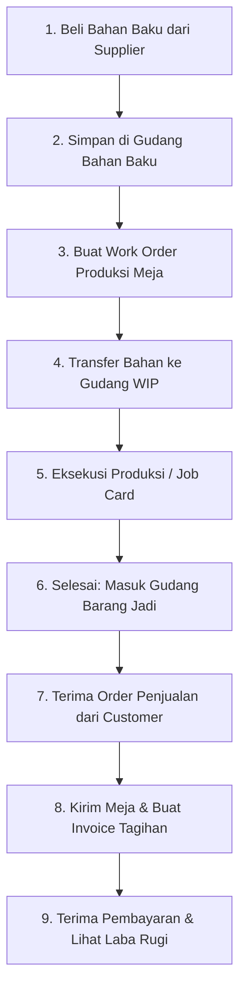

# PANDUAN LENGKAP PRAKTIK ERPNEXT: INDUSTRI MANUFAKTUR
## KASUS: PT SHANTI MANUFAKTUR MANDIRI (FURNITURE & MEBEL)

---

### 1. PROFIL PERUSAHAAN
* **Nama Perusahaan:** PT Shanti Manufaktur Mandiri
* **Tipe Bisnis:** Manufaktur Meja & Kursi Belajar Kayu Minimalis (Rangka Besi)
* **Mata Uang:** IDR (Rupiah)
* **Tahun Fiskal:** 1 Januari - 31 Desember

---

### 2. STRUKTUR MASTER DATA MANUFAKTUR

#### A. Gudang (Warehouses)
1. **Gudang Bahan Baku**: Tempat menyimpan kayu, besi, sekrup, lem, dan cat yang dibeli dari supplier.
2. **Gudang Work In Progress (WIP)**: Lantai produksi/bengkel kerja tempat barang sedang dipotong, dirakit, dan dicat.
3. **Gudang Barang Jadi (Finished Goods)**: Tempat meletakkan meja yang sudah selesai diproduksi dan siap dijual.

#### B. Produk Jadi & Bahan Baku (Items)
* **Produk Jadi (Finished Good):**
  * `FG-MB-001` - Meja Belajar Shanti Minimalis (Harga Jual: Rp 750.000)
* **Bahan Baku (Raw Materials):**
  * `RM-KY-001` - Papan Kayu Mahoni 100x50 cm (Rp 45.000 / Lembar)
  * `RM-BS-001` - Pipa Besi Hollow 4x4 cm (Rp 60.000 / Meter)
  * `RM-SK-001` - Sekrup Kayu 2 Inch (Rp 15.000 / Box isi 50)
  * `RM-LM-001` - Lem Kayu PVAc 500g (Rp 22.000 / Botol)
  * `RM-VR-001` - Cat Vernis Polyurethane 1L (Rp 70.000 / Kaleng)
  * `RM-AP-001` - Amplas Kayu Grid 120 (Rp 6.000 / Lembar)

#### C. Stasiun Kerja (Workstations) & Tarif Biaya Operasi
1. **Stasiun Pemotongan**: Mesin potong kayu & pemotong pipa besi (Tarif: Rp 35.000 / jam)
2. **Stasiun Perakitan**: Meja kerja rakit & bor baut (Tarif: Rp 30.000 / jam)
3. **Stasiun Finishing Cat**: Booth spray gun & pengeringan cat (Tarif: Rp 25.000 / jam)

#### D. Operasi Produksi (Operations)
1. **Pemotongan Bahan**: Waktu standar 30 menit (di Stasiun Pemotongan).
2. **Perakitan Rangka & Daun Meja**: Waktu standar 45 menit (di Stasiun Perakitan).
3. **Pengamplasan & Pengecatan Vernis**: Waktu standar 30 menit (di Stasiun Finishing Cat).

#### E. Bill of Materials (BOM) — Resep Pembuatan 1 Unit Meja `FG-MB-001`
* **Komponen Bahan Baku:**
  * Papan Kayu: 2 Lembar (Rp 90.000)
  * Pipa Besi: 1 Meter (Rp 60.000)
  * Sekrup: 0.2 Box / 10 biji (Rp 3.000)
  * Lem Kayu: 0.25 Botol (Rp 5.500)
  * Cat Vernis: 0.2 Kaleng (Rp 14.000)
  * Amplas: 0.5 Lembar (Rp 3.000)
  * *Subtotal Biaya Bahan:* **Rp 175.500**
* **Operasi / Biaya Tenaga & Mesin:**
  * Pemotongan: 30 menit (Rp 17.500)
  * Perakitan: 45 menit (Rp 22.500)
  * Finishing Cat: 30 menit (Rp 12.500)
  * *Subtotal Biaya Operasi:* **Rp 52.500**
* **Total Harga Pokok Produksi (HPP):** **Rp 228.000 / Unit**
* **Target Margin Laba Kotor:** Rp 750.000 - Rp 228.000 = **Rp 522.000 / Unit** (~69.6%)

---

### 3. ALUR KERJA SIMULASI (STEP-BY-STEP)

Lihat detail transaksi langkah demi langkah pada file `07_Skenario_Simulasi_Transaksi.md`.
