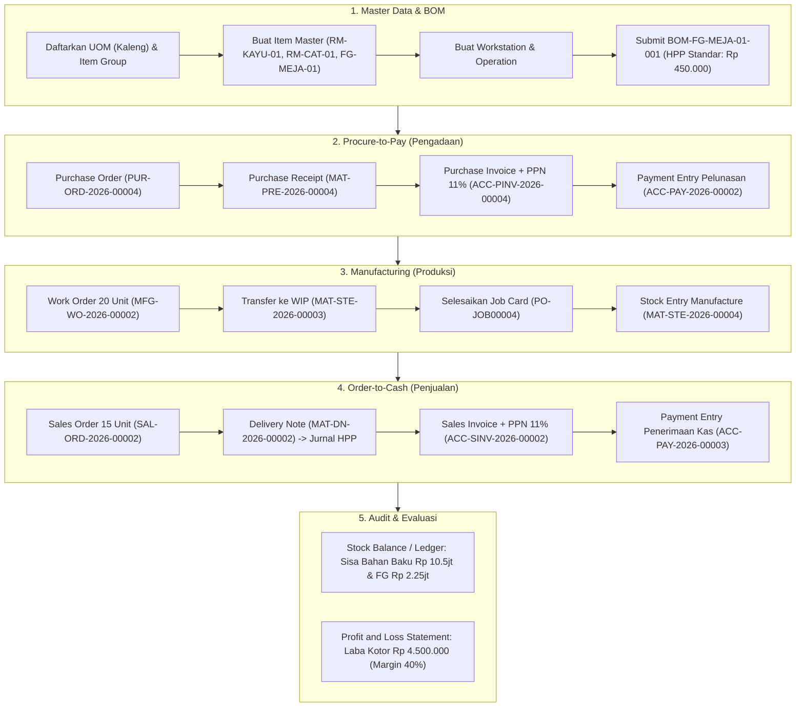

# PANDUAN TUTORIAL & SKEMA PELAKSANAAN STUDI KASUS MANUFAKTUR ERPNEXT

**Entitas:** PT Shanti Manufaktur Mandiri (`SHANTI`)  
**Versi Sistem:** ERPNext v16.34.2 (Frappe Framework)  
**Basis Bagan Akun:** Standar 108 Kode Akun Industri Manufaktur (`kode_akun_erpnext_manufaktur.xlsx`)  
**Status Eksekusi:** 100% Selesai & Terverifikasi di Database  

---

## 1. Skema Alur Integrasi Transaksi Manufaktur

Proses bisnis end-to-end pada latihan ini mencakup 5 siklus utama yang terintegrasi secara otomatis antara modul operasional dan akuntansi:

---

## 2. Tutorial Pengerjaan Soal 1: Master Data & BOM

### Tujuan:
Mempersiapkan data master komponen, satuan, pusat kerja, dan resep produksi (*Bill of Materials*) untuk produk **Meja Kayu Minimalis (`FG-MEJA-01`)**.

### Langkah di UI ERPNext:
1. **Membuat UOM 'Kaleng':**
   - Ketik `UOM List` di Awesomebar atas ➔ Klik **Add UOM**.
   - Isi UOM Name: `Kaleng`, hapus centang *Must be Whole Number* ➔ Klik **Save**.
2. **Membuat Kategori 'Finished Goods':**
   - Ketik `Item Group List` ➔ Klik **Add Item Group**.
   - Item Group Name: `Finished Goods`, Parent: `All Item Groups` ➔ Klik **Save**.
3. **Mendaftarkan Master Item (Stock > Item):**
   - `RM-KAYU-01`: Kayu Jati Board 200x20x3cm | Group: *Raw Material* | UOM: *Unit* | Valuasi: Rp 150.000 | Gudang Bawaan: *Gudang Bahan Baku - SHANTI*.
   - `RM-CAT-01`: Cat Finishing Wood Gloss | Group: *Raw Material* | UOM: *Kaleng* | Valuasi: Rp 50.000 | Gudang Bawaan: *Gudang Bahan Baku - SHANTI*.
   - `FG-MEJA-01`: Meja Kayu Minimalis | Group: *Finished Goods* | UOM: *Unit* | Harga Jual Standar: Rp 750.000 | Gudang Bawaan: *Gudang Barang Jadi - SHANTI*.
4. **Membuat Workstation & Operation (Manufacturing):**
   - Buat Workstation: `Workstation Perakitan & Finishing` (Hour Rate: Rp 100.000).
   - Buat Operation: `Perakitan & Finishing Meja` terhubung ke Workstation tersebut.
5. **Menerbitkan BOM (`BOM-FG-MEJA-01-001`):**
   - Buka **Manufacturing > Bill of Materials** ➔ Klik **Add BOM**.
   - Item: `FG-MEJA-01`, Qty: 1 Unit, Centang *With Operations*.
   - Items:
     - 2 Unit `RM-KAYU-01` @ Rp 150.000 = Rp 300.000
     - 1 Kaleng `RM-CAT-01` @ Rp 50.000 = Rp 50.000
   - Operations: 1 Jam Perakitan & Finishing = Rp 100.000.
   - Klik **Save** ➔ Klik **Submit**.

> **Jawaban Evaluasi Soal 1:**  
> $\text{HPP Standar} = \text{Rp } 300.000 + \text{Rp } 50.000 + \text{Rp } 100.000 = \mathbf{\text{Rp } 450.000\text{ / unit}}$.

---

## 3. Tutorial Pengerjaan Soal 2: Siklus Procure-to-Pay (P2P)

### Tujuan:
Pengadaan bahan baku dari **PT Kayu Utama**, pengakuan utang usaha dan pajak PPN Masukan 11%, serta pelunasan melalui transfer bank.

### Langkah di UI ERPNext:
1. **Pendaftaran Pemasok:**
   - **Buying > Supplier** ➔ Tambah `PT Kayu Utama` (Group: *Local*).
2. **Purchase Order (`PUR-ORD-2026-00004`):**
   - **Buying > Purchase Order** ➔ Add PO.
   - Supplier: `PT Kayu Utama`, Target Warehouse: `Gudang Bahan Baku - SHANTI`.
   - Items: 100 Unit `RM-KAYU-01` (@ Rp 150.000 = Rp 15.000.000) & 50 Kaleng `RM-CAT-01` (@ Rp 50.000 = Rp 2.500.000).
   - Taxes: `Purchase Tax - SHANTI` (PPN Masukan 11% = Rp 1.925.000).
   - Grand Total = Rp 19.425.000 ➔ **Save & Submit**.
3. **Penerimaan Fisik (Purchase Receipt: `MAT-PRE-2026-00004`):**
   - Dari dokumen PO, klik tombol **Create > Receipt** ➔ **Save & Submit**.
4. **Faktur Pemasok (Purchase Invoice: `ACC-PINV-2026-00004`):**
   - Dari PO atau PR, klik **Create > Invoice** ➔ Total tagihan Rp 19.425.000 ➔ **Save & Submit**.
5. **Pelunasan Kas/Bank (Payment Entry: `ACC-PAY-2026-00002`):**
   - Dari Invoice, klik **Create > Payment**.
   - Paid From: `1121 - Bank BCA Utama - SHANTI`, Paid To: `2111 - Hutang Dagang Pemasok Lokal - SHANTI`.
   - Reference No: `TRF-KAYU-01` ➔ **Save & Submit**.

### Jurnal Akuntansi Otomatis:
| Dokumen | Akun Debit | Akun Kredit | Nominal (Rp) | Keterangan |
| :--- | :--- | :--- | :---: | :--- |
| **Purchase Receipt** | 1141 - Persediaan Bahan Baku | 1147 - Stock Received Not Billed | 17.500.000 | Pengakuan aset stok masuk |
| **Purchase Invoice** | 1147 - Stock Received Not Billed 1161 - PPN Masukan (11%) | 2111 - Hutang Dagang Pemasok | 17.500.000 1.925.000 *(Kredit: 19.425.000)* | Kliring penerimaan & pengakuan utang |
| **Payment Entry** | 2111 - Hutang Dagang Pemasok | 1121 - Bank BCA Utama | 19.425.000 | Pelunasan tagihan via bank |

---

## 4. Tutorial Pengerjaan Soal 3: Siklus Produksi & Akuntansi Manufaktur

### Tujuan:
Memproduksi 20 unit `FG-MEJA-01`, mengonsumsi bahan baku ke WIP, merekam jam kerja operator, dan memasukkan hasil jadi ke gudang barang jadi dengan HPP aktual Rp 450.000/unit.

### Langkah di UI ERPNext:
1. **Work Order (`MFG-WO-2026-00002`):**
   - **Manufacturing > Work Order** ➔ Add Work Order.
   - Production Item: `FG-MEJA-01`, Qty: 20 Unit, BOM: `BOM-FG-MEJA-01-001`.
   - WIP Warehouse: `Gudang Work In Progress - SHANTI`, FG Warehouse: `Gudang Barang Jadi - SHANTI`.
   - **Save & Submit**.
2. **Transfer Bahan ke Produksi (`MAT-STE-2026-00003`):**
   - Dari Work Order, klik **Create > Material Transfer**.
   - Terpotong: 40 Unit Kayu (Rp 6.000.000) dan 20 Kaleng Cat (Rp 1.000.000) ke Gudang WIP (Total Rp 7.000.000).
   - **Save & Submit**.
3. **Penyelesaian Job Card (`PO-JOB00004`):**
   - Buka Job Card dari tab Operations pada Work Order.
   - Masukkan durasi pengerjaan: 240 Menit (20 unit selesai) ➔ **Save & Submit**.
4. **Penyelesaian Barang Jadi (Stock Entry Manufacture: `MAT-STE-2026-00004`):**
   - Dari Work Order, klik **Create > Manufacture**.
   - Target: 20 Unit `FG-MEJA-01` masuk ke `Gudang Barang Jadi - SHANTI`.
   - Pada tabel **Additional Costs**: Tambahkan biaya operasional aktual Rp 2.000.000 ke akun `5120 - Biaya Angkut Pembelian Bahan Baku - SHANTI`.
   - Total Incoming Value = Rp 9.000.000 (HPP Aktual = **Rp 450.000 / unit**) ➔ **Save & Submit**.

### Jurnal Akuntansi Manufaktur:
| Tahap | Debit | Kredit | Nilai (Rp) | Dampak Posisi |
| :--- | :--- | :--- | :---: | :--- |
| **Transfer ke WIP** | 1143 - Persediaan WIP | 1141 - Persediaan Bahan Baku | 7.000.000 | Baku berkurang, WIP bertambah |
| **Manufacture Entry** | 1144 - Persediaan Barang Jadi | 1143 - Persediaan WIP 5120 - Biaya Valuasi Operasi | 9.000.000 *(Kredit: 7.000.000) (Kredit: 2.000.000)* | WIP dikosongkan, Barang Jadi terbentuk @ Rp 450.000 |

---

## 5. Tutorial Pengerjaan Soal 4: Siklus Penjualan (Order-to-Cash)

### Tujuan:
Menjual 15 unit Meja ke **PT Furniture Indah**, mengeluarkan barang fisik dari gudang, mengakui HPP, menerbitkan faktur pajak PPN Keluaran 11%, dan menerima pelunasan.

### Langkah di UI ERPNext:
1. **Pendaftaran Pelanggan:**
   - **Selling > Customer** ➔ Tambah `PT Furniture Indah` (Group: *Commercial*).
2. **Sales Order (`SAL-ORD-2026-00002`):**
   - **Selling > Sales Order** ➔ Add SO.
   - Customer: `PT Furniture Indah`, Item: 15 Unit `FG-MEJA-01` @ Rp 750.000 = Rp 11.250.000.
   - Taxes: `Sales Tax - SHANTI` (PPN Keluaran 11% = Rp 1.237.500) ➔ Total Rp 12.487.500 ➔ **Save & Submit**.
3. **Surat Jalan / Pengiriman (Delivery Note: `MAT-DN-2026-00002`):**
   - Dari Sales Order, klik **Create > Delivery** ➔ **Save & Submit**.
   - *Sistem otomatis menjurnal:* Beban HPP (Debit Rp 6.750.000) dan Persediaan Barang Jadi (Kredit Rp 6.750.000).
4. **Faktur Penjualan (Sales Invoice: `ACC-SINV-2026-00002`):**
   - Dari Sales Order atau Delivery Note, klik **Create > Invoice** ➔ Total Piutang Rp 12.487.500 ➔ **Save & Submit**.
5. **Penerimaan Kas Pelunasan (Payment Entry: `ACC-PAY-2026-00003`):**
   - Dari Sales Invoice, klik **Create > Payment**.
   - Paid To: `1121 - Bank BCA Utama - SHANTI`, Paid From: `1131 - Piutang Dagang Lokal - SHANTI`.
   - Nominal: Rp 12.487.500 ➔ **Save & Submit**.

---

## 6. Tutorial Pengerjaan Soal 5: Evaluasi Laporan Keuangan & Kartu Stok

### A. Perhitungan Laba Kotor (Profit and Loss Statement):
Buka menu **Accounting > Profit and Loss Statement**:
- **Pendapatan Penjualan (`4110`):** 15 Unit x Rp 750.000 = **Rp 11.250.000**
- **Beban Pokok Penjualan / HPP (`5110`):** 15 Unit x Rp 450.000 = **(Rp 6.750.000)**
- **Laba Kotor (*Gross Profit*):** Rp 11.250.000 - Rp 6.750.000 = **Rp 4.500.000**
- **Gross Profit Margin:** $\frac{\text{Rp } 4.500.000}{\text{Rp } 11.250.000} \times 100\% = \mathbf{40,0\%}$

### B. Rekonsiliasi Saldo Persediaan Akhir (Stock Balance):
Buka menu **Stock > Stock Balance**:
| Lokasi Gudang | Item Code & Deskripsi | Mutasi Kuantitas | Nilai Satuan | Total Nilai Persediaan |
| :--- | :--- | :---: | :---: | :---: |
| **Gudang Bahan Baku** | `RM-KAYU-01` Kayu Jati | Beli 100 - Pakai 40 = **60 Unit** | Rp 150.000 | **Rp 9.000.000** |
| **Gudang Bahan Baku** | `RM-CAT-01` Cat Finishing | Beli 50 - Pakai 20 = **30 Kaleng** | Rp 50.000 | **Rp 1.500.000** |
| **Gudang WIP** | Bahan Dalam Proses | 20 Masuk - 20 Selesai = **0 Unit** | Rp 0 | **Rp 0 (Nihil)** |
| **Gudang Barang Jadi** | `FG-MEJA-01` Meja Kayu | Produksi 20 - Terjual 15 = **5 Unit** | Rp 450.000 | **Rp 2.250.000** |
| **Total Persediaan Akhir** | | | | **Rp 12.750.000** |

---

## 7. Rekapitulasi Dokumen Resmi ERPNext (Audit Trail)

| Jenis Dokumen | Nomor Referensi Sistem | Deskripsi Transaksi |
| :--- | :--- | :--- |
| **BOM** | `BOM-FG-MEJA-01-001` | Resep Standar Meja Kayu Minimalis (HPP Rp 450.000) |
| **Purchase Order** | `PUR-ORD-2026-00004` | Pembelian 100 Kayu & 50 Cat ke PT Kayu Utama |
| **Purchase Receipt** | `MAT-PRE-2026-00004` | Penerimaan fisik material di Gudang Bahan Baku |
| **Purchase Invoice** | `ACC-PINV-2026-00004` | Faktur Pembelian Pemasok beserta PPN Masukan 11% |
| **Payment Entry (PO)** | `ACC-PAY-2026-00002` | Pembayaran Rp 19.425.000 ke PT Kayu Utama via Bank BCA |
| **Work Order** | `MFG-WO-2026-00002` | Perintah Kerja Perakitan 20 Unit Meja Kayu Minimalis |
| **Material Transfer** | `MAT-STE-2026-00003` | Pemindahan bahan baku Rp 7.000.000 dari Baku ke WIP |
| **Job Card** | `PO-JOB00004` | Realisasi 240 menit kerja operator di Workstation Perakitan |
| **Manufacture Entry** | `MAT-STE-2026-00004` | Penerimaan 20 unit Meja (Valuasi Rp 9.000.000) ke Gudang Jadi |
| **Sales Order** | `SAL-ORD-2026-00002` | Pesanan 15 Meja dari PT Furniture Indah |
| **Delivery Note** | `MAT-DN-2026-00002` | Pengiriman fisik 15 Meja (Pembebanan HPP Rp 6.750.000) |
| **Sales Invoice** | `ACC-SINV-2026-00002` | Faktur Penjualan komersial beserta PPN Keluaran 11% |
| **Payment Entry (SO)** | `ACC-PAY-2026-00003` | Penerimaan transfer pelunasan Rp 12.487.500 dari pelanggan |
